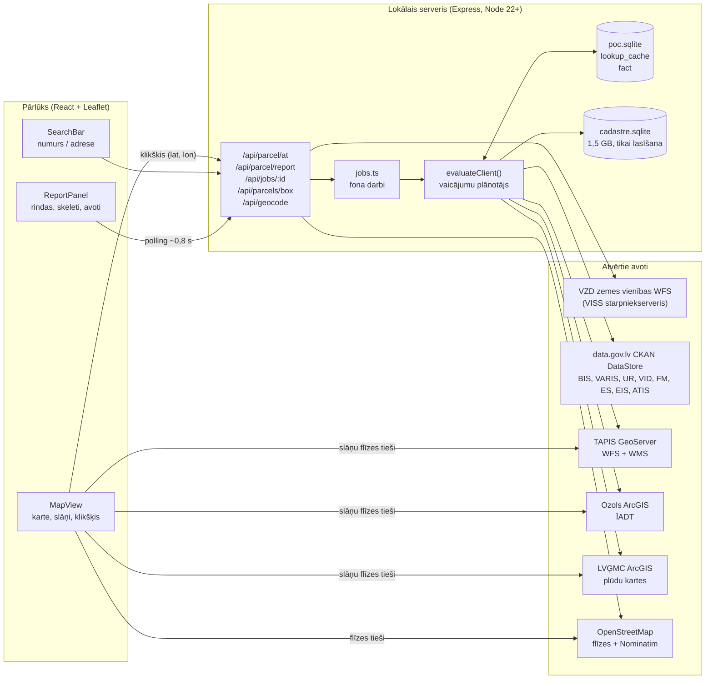
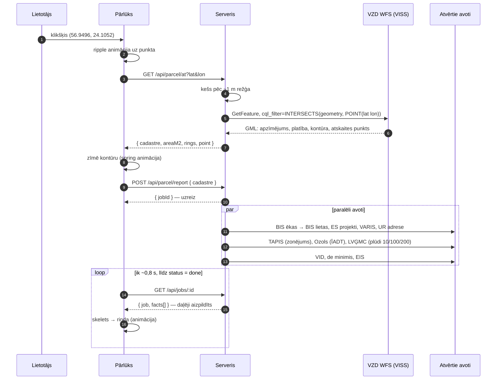

# Vienotais Zemes Reģistrs — tehniskā dokumentācija

Šis dokuments izskaidro, **kā Vienotais Zemes Reģistrs darbojas** un **kā tas tehniski saņem datus**: no klikšķa uz kartes līdz katrai rindai pārskatā, ar visiem pieprasījumiem, koordinātu sistēmu kļūmēm un kešošanu.

> Viens teikums: lietotājs uzklikšķina uz zemes vienības, serveris pēc punkta atrod kadastra apzīmējumu, pēc tam paralēli pavaicā astoņus atvērto datu avotus un rindu pa rindai atdod pārlūkam. Katrai rindai līdzi nāk avots, laika zīmogs un precīzais pieprasījums.

---

## 1. Ko tā dara

| Lietotājs dara | Sistēma atbild |
|---|---|
| Uzklikšķina jebkur Latvijā | Zemes vienības robeža kartē + kadastra numurs, platība |
| Skatās labajā panelī | Īpašums, ierobežojumi, plānošana, būvniecība, ES projekti šajā kadastrā, CFLA atvērtās atlases, EKII mājsaimniecību AER, LIAA atbalsts, uzņēmumi adresē |
| Nospiež **Avots** pie rindas | Atver oficiālo reģistru tieši uz šo ierakstu |
| Nospiež **Pieprasījums** | Atver precīzo API pieprasījumu, kas atdeva šo vērtību |
| Pārslēdz slāni (Plūdi, Zonējums, Daba, Kadastrs) | Valsts karšu slānis virs OpenStreetMap |
| Meklē pēc numura vai adreses | Karte aizlido un atver to pašu pārskatu |
| Kopē saiti / drukā / lejupielādē JSON | `#/?cad=…` deep link, A4 pārskats, mašīnlasāms eksports |

Ko tā **nedara** (apzināti):

- nedod vērtējumu, riska punktus vai „atzinumu”;
- neparāda fizisku personu vārdus — atvērtajā kopā to nav, un mēs neko nepērkam un nevācam;
- neizmanto maksas datus, API atslēgas vai pieteikšanās sistēmas (ELRG). CFLA izsludinātās atlases CKAN nav — tās nāk no oficiālās HTML tabulas `cfla.gov.lv/lv/2021-2027-programmas`, ar kešu ~6 h. Katrai atvērtai atlasei lasa tās oficiālo lapu un nolikuma DOCX un **automātiski atzīmē atbilstību** pēc īpašnieka veida / komersanta adresē pret CFLA lauku „kas var pieteikties”, tad pret nolikuma NACE / MVU / de minimis nosacījumiem. Tas nav CFLA lēmums un ELRG netiek vaicāts. EKII / LVIF mājsaimniecību AER (saules, siltumsūkņi u.c.) tāpat nāk no HTML (`ekii.lv` konkursi + `lvif.gov.lv` AER lapa), ne no CKAN — data.gov.lv KPFI/EKII XLSX ir tikai jau īstenotie projekti (~2020) un netiek lasīts kā atvērto konkursu avots.

---

## 2. Arhitektūra



**Kāpēc serveris vispār vajadzīgs?** Pārlūks nevar droši runāt ar katru valsts servisu (CORS, dažādi formāti, lēni timeouti) un nevar turēt 1,5 GB kadastra indeksu. Serveris ir plāns „tulks”: viens vienkāršs JSON uz priekšu, desmit dažādi protokoli uz aizmuguri.

### Komponenti

| Daļa | Fails | Uzdevums |
|---|---|---|
| Karte | `src/components/MapView.tsx` | Leaflet (npm, nevis CDN), OSM pamatne, ArcGIS un WMS slāņi, izvēlētās zemes vienības kontūra, zemes vienību mozaīka |
| Panelis | `src/components/ReportPanel.tsx`, `FactRow.tsx` | Rindas pa sekcijām, skeleti, avotu saites; telefonā — apakšējā loksne ar trim pozīcijām |
| Meklēšana | `src/components/SearchBar.tsx` | 11–17 cipari → numurs; pārējais → adrese (Nominatim) |
| Plūsma | `src/App.tsx` | Klikšķis → zemes vienība → atskaite → polling; deep link |
| Klikšķa API | `server/adapters/geo.ts` (`lookupParcelAt`) | WFS CQL `INTERSECTS` ar punktu |
| Plānotājs | `server/services/evaluate.ts` | Zina, kuram laukam kurš avots un kādā secībā |
| Adapteri | `server/adapters/*.ts` | Viens fails uz protokolu: `ckan`, `geo`, `eval`, `open`, `ur`, `vid`, `geocode` |
| Fona darbi | `server/jobs.ts` | Atskaite skrien fonā; pārlūks tikai jautā progresu |
| Kešs | `server/db.ts` | SQLite `lookup_cache`, derīgums 24 h |
| Kadastra indekss | `server/cadastreDb.ts`, `server/indexCadastre.ts` | VZD XML izgāztuves → SQLite |

---

## 3. No klikšķa līdz rindai (secība)



Svarīgi: **atskaite nav „viss vai nekas”**. Katrs avots raksta savas rindas, tiklīdz tas atbild (`evaluate.ts`: katram `lookup…` ir sava `.then(write…)`). Ātrie avoti (vietējais kadastra indekss, CKAN) parādās pirmajā sekundē, lēnie ģeoservisi — kad tie atbild. Lēns Ozols neaizklāj plūdu vai zonējuma rindu.

### API

| Maršruts | Atbilde |
|---|---|
| `GET /api/parcel/at?lat&lon` | `{ parcel: { cadastre, areaM2, point, rings, requestUrl, fetchedAt } \| null }` |
| `GET /api/parcel/:cadastre` | tas pats, pēc numura (meklētājs, deep link) |
| `GET /api/parcels/box?s&w&n&e` | līdz 600 zemes vienību kontūru vienai režģa flīzei („Kadastrs” slānis) |
| `GET /api/parcel/:cadastre/buildings` | `{ buildings: [{ code, name, built, rings, use, condition, floors, dwellings, units, varisRef, recorded }], requestUrl, fetchedAt }` — ēkas uz zemes vienības (oranžā izgaismošana) |
| `GET /api/building/:code` | `{ code, bis, case, statuses, properties, separate, address, encumbrances, index, sources, fetchedAt }` — būves kartīte pēc 14 ciparu apzīmējuma: BIS būve un lieta, kadastra dumpa statuss (bez vārdiem), adrese, apgrūtinājumi; kešs 24 h |
| `GET /api/geocode?q=` | līdz 5 adrešu variantu (OSM Nominatim) |
| `POST /api/parcel/report` | `{ cadastre, applicant?, force? }` → `{ jobId, facts }` |
| `GET /api/jobs/:id` | `{ job: { status, … }, facts[] }` |
| `GET /api/fields`, `GET /api/sources` | lauku saraksts, avotu matrica |
| `GET /api/health` | dzīvības pārbaude + CKAN/Ozols/TAPIS ping + vai kadastra indekss ir vietā |

---

## 4. Kā dati tiek saņemti — avots pa avotam

### 4.1 Zemes vienība zem klikšķa (VZD kadastrs, INSPIRE `CadastralParcel`)

- Endpoint: VISS starpniekserveris `geo-dpps.viss.gov.lv/api/DPPSPackage/client/Zemes_vien_423_…` (pats `grafws.kadastrs.lv` no šīs vides savienojumu nepieņem).
- Protokols: OGC WFS 2.0.0, `GetFeature`, `typeNames=cp:CadastralParcel`.
- Klikšķis: `cql_filter=INTERSECTS(geometry,POINT(lat lon))`, `count=1`.
- No atbildes GML tiek izņemts: `cp:label` (11 ciparu apzīmējums), `cp:areaValue`, `gml:posList` (kontūra), `cp:referencePoint`.
- Kartes logs: `cql_filter=BBOX(geometry,west,south,east,north)` (sk. 5. nodaļu — **cita ass secība**).
- Rezultāts tiek iekešots arī zem vecajām atslēgām (`vzd:parcel:ring:v1:…`, `vzd:parcel:v1:…`), lai atskaite pēc klikšķa neprasa to pašu otrreiz.
- „Kadastrs” slānis prasa pa **fiksēta režģa flīzēm** (0,005° × 0,01°), nevis pa ekrāna logu. Tās pašas četras koordinātas atkārtojas katrā pārvietošanā, tāpēc trāpa gan pārlūka LRU (300 flīzes), gan servera kešs. Jauns pans atceļ vecos pieprasījumus (`AbortController`), un karte zīmē tikai starpību (`Map<kadastrs, L.Polygon>`), bez `clearLayers` — nekas nemirgo.

### 4.1a Ēkas uz zemes vienības (VZD INSPIRE `bu:Building`)

- Endpoint: VISS starpniekserveris `Ekas_un_bu_419_kg61P8/…` (ģeoprodukts 135). Pirmā pakete `…_219_…` atbild „Service WFS is disabled”.
- Darbojas tikai `bbox=s,w,n,e,urn:ogc:def:crs:EPSG::4258` (platums pirmais). CQL `INTERSECTS` krīt ar „targetCRS should not be null”.
- Ņem zemes vienības kontūras bbox, tad patur ēkas, kuru `CB…` apzīmējums sākas ar šīs zemes vienības 11 cipariem **vai** kuru centrs ir kontūrā (pēc sadalīšanas vecais prefikss mēdz palikt).
- Kartē tās iedegas oranžā (`path.building-lit`, atsperes animācija ar 40 ms soli); panelī — rinda „Būves uz zemes vienības”.

### 4.2 Kadastra indekss (īpašuma tiesības, adrese, apgrūtinājumi, saistītie objekti)

VZD publicē četras XML izgāztuves (`ownership`, `address`, `property`, `encumbrance`), bet **CKAN DataStore tās neatver** — pēc numura vaicāt nevar. Tāpēc:

1. `npm run setup:data` (`server/indexCadastre.ts`) lejupielādē ZIP, izpako (~4,9 GB XML) un **straumē** cauri ar 1 MB buferi (XML ir viena gara rinda — meklējam `<OwnershipItemData>…</OwnershipItemData>` ar „carry” buferi).
2. Ieraksti iet SQLite tabulās ar pakešu `COMMIT` ik 20 000 rindām, beigās tiek izveidoti indeksi.
3. Gala fails `data/cadastre.sqlite` ir ~1,5 GB: `owner` 1 695 079 rindas, `address` 2 720 971, `link` 4 280 099, `encumbrance` 4 790 797.
4. Izpildlaikā tas tiek atvērts **tikai lasīšanai** (`new DatabaseSync(path, { readOnly: true })`); vaicājums pēc numura ir indeksa meklēšana, milisekundes.

Īpašuma tiesības atvērtajā kopā ir **tikai statuss un personas veids** (īpašnieks / tiesiskais valdītājs / lietotājs; fiziska / juridiska persona / pašvaldība / valsts). Vārda un personas koda tur nav, un mēs tos nemeklējam.

`relatedNumbers()` paplašina meklējamo numuru ar `link` tabulu: zemes vienības numurs ↔ īpašuma numurs ↔ ēkas apzīmējums, lai vienai zemei atrastu visu, kas pie tās piesaistīts.

### 4.3 Atvērto datu CKAN DataStore (data.gov.lv)

Visi `datastore_search` pieprasījumi iet caur `server/adapters/ckan.ts`:

```
GET https://data.gov.lv/dati/lv/api/3/action/datastore_search
    ?resource_id=<uuid>&filters=<json>&limit=…
```

- vispirms precīzs `filters`, tad pilnteksta `q` kā rezerves variants (dažas kolonnas ir skaitliskas, dažas teksta);
- timeouts 15 s, kļūda tiek atgriezta kā `error`, nevis izmesta;
- atslēga ietver `resource_id`, lai UR papildu kopas nepārraksta galveno reģistru.

| Lauks panelī | Avots | Resurss / metode |
|---|---|---|
| Kadastra numurs, apzīmējums, adrese, tiesības | VZD (vietējais indekss) + BIS | `cadastre.sqlite`; BIS ēkas `f41f3ee3-…` |
| Apgrūtinājumi | VZD apgrūtinājumu XML + ATIS klasifikators | `encumbrance` tabula; kods → apraksts no CKAN `072603f8-…` |
| Zonējums, plānošanas dokuments | TAPIS (VRAA) | WFS `funkcionalais_zonejums`, punkts pret poligonu |
| Plūdi 10 / 100 / 200 g. | LVĢMC | ArcGIS FeatureServer, punkts pret plūdu poligonu |
| Īpaši aizsargājamās dabas teritorijas | DAP / Ozols | ArcGIS FeatureServer, punkts pret ĪADT poligonu |
| Mikroliegums, aizsargājams biotops | DAP / Ozols | tas pats Ozols vaicājums (Hosted `Mikroliegumi_GNP` / GIS slānis 1, `Īpaši_aizsargājamie_biotopi`), katram sava kļūda |
| Kultūras piemineklis | NKMP | CKAN `25583e4e-…` pēc adreses; pilsēta + iela + mājas numurs (kadastra kolonna ir sabojāta Excel formātā) |
| Zemesgrāmata | Tiesu administrācija | tikai saite uz nodalījumu pēc kadastra numura — īpašnieka vārda atvērtajos datos nav |
| Būves uz zemes vienības | VZD INSPIRE „Ēkas” | WFS `bu:Building`, sk. 4.1a |
| Būvniecības lietas | BVKB / BIS | CKAN `f41f3ee3-…` (ēkas) → `4f5648b2-…` (lietas pēc numura) |
| ES projekti šajā kadastrā | CFLA īstenošanas vietas + projektu saraksts | CKAN vietas `35da9d99-…` / `27733f45-…` / `fec77132-…`, tad saraksts pēc `ProjektaNumurs` |
| CFLA atvērtās atlases | CFLA 2021–2027 programmu lapa + katras atlases lapa + nolikums | HTML tabula (`Izsludināts`), tad `.content` lauki (iesniedzējs, veids, atlikušais EUR), tad nolikuma DOCX (`server/adapters/nolikums.ts`). Palīgs: `cfla.gov.lv/lv/paligs-projektu-iesniedzejiem` |
| EKII mājsaimniecību AER | LVIF / ekii.lv atvērtie konkursi | HTML tabula (`Iesniegumu pieņemšana`), bagātināšana no LVIF AER lapas. Atbilst: fiziska persona vai juridiska bez UR komersanta. CKAN KPFI/EKII XLSX = realizētie, ne open-calls |
| LIAA atbalsts uzņēmumam | LIAA pakalpojumu saraksts | CKAN `03f2b47a-…`, turētājs = LIAA, valoda lv. Bez kadastra — rāda tikai ja adresē ir komersants |
| Uzņēmumi adresē | Uzņēmumu reģistrs | CKAN `25e80bf3-…`, filtrs pēc adreses koda no VARIS |
| VID reitings | VID | CKAN `acd4c6f9-…` |
| De minimis | Finanšu ministrija | CKAN `6253edd2-…`; kopsumma, tad 3 gadu logs pēc `assign_date` un atlikums līdz 300 000 EUR (2023/2831) |
| Uzņēmuma profils atbilstībai | UR gada pārskati + VID | CKAN `27fcc5ec-…` (darbinieki) → `d5fd17ef-…` (apgrozījums) / `50ef4f26-…` (bilance) pēc `statement_id`; NACE no `a42d6e8c-…` |
| Iepirkumi | IUB / EIS | CKAN `f2a08974-…` (pa gadiem) |

Pilns saraksts ar licencēm un ierobežojumiem ir arī lietotnē: poga **Dati** → `server/sources.ts`.

### 4.4 Ģeoservisi: punkts pret poligonu

- **TAPIS** — GeoServer WFS (`…/geoserver/tapis_apvienotie/wfs`). Globālais `/ows` katalogs slāni uzskaita, bet `GetFeature` atbild tikai uz darba telpas ceļu bez prefiksa. Tiek prasīts ierobežots lauku saraksts, lai nelejupielādētu visu Rīgas poligonu.
- **Ozols** — ArcGIS `FeatureServer/query`, `geometryType=esriGeometryPoint`, `spatialRel=esriSpatialRelIntersects`. Ja ir LKS-92 koordinātes, sūtām `inSR=3059`, citādi 4326.
- **LVĢMC** — tas pats ArcGIS, trīs scenāriju slāņi (upes 10/100/200 g. + atbilstošie jūras vēja uzplūdi). Ja serviss nav pieejams, rinda saka „nav datu”, **nevis „Nē”**.

Kartes slāņi (flīzes) pārlūkā netiek vaicāti caur serveri: `ArcgisExportLayer` aprēķina katras 256×256 flīzes Web Mercator (EPSG:3857) ierobežojošo kasti un liek `MapServer/export?…` kā `` — tam nevajag CORS un nevajag flīžu kešu uz valsts servisa.

### 4.5 Uzņēmumi adresē un uzņēmuma pārbaude

Adreses kods (`ARCode`) nāk no kadastra adreses ieraksta vai BIS. Ar to UR kopā meklē subjektus **tikai ar šo pašu kodu** — pilnteksta meklēšana pēc ielas jauc kaimiņu mājas, tāpēc tā netiek lietota.

VID reitings, de minimis, iepirkumi un **LIAA atbalsts** ir par **personu**, nevis par zemi. Pēc noklusējuma tie seko uzņēmumiem adresē. Ja panelī ievada 11 ciparu reģistrācijas numuru, tie sekos tieši tam (`applicant`).

CFLA atvērtās atlases ir nacionāls saraksts, bet panelī rādās **tikai atbilstošās** šim gabalam. Gabala fakti (īpašnieka veids, komersants adresē) atbilst pret CFLA iesniedzēja lauku; ierobežota atlase ar konkrētu iestādi (LVM, DAP) — tikai ja tāds nosaukums ir UR šajā adresē. Pārējās atvērtās atlasēs netiek rādītas (saite uz CFLA programmu tabulu ir piezīmē).

EKII mājsaimniecību AER (`ekii_atbalsts`) tāpat rāda tikai atbilstošos atvērtos konkursus (tipiski EKII-6 saules/siltums, EKII-10 iedzīvotāju transports). Fiziska persona vai juridiska bez UR komersanta → Atbilst; komersants / pašvaldība / valsts → Nē ar saiti uz `ekii.lv`. ALTUM DME (daudzdzīvokļi) šajā iterācijā nav.

Otrā kārta ir **nolikums**. Atlases lapā atrod DOCX ar „nolikums” nosaukumā (ne „pielikums”), izpako `word/document.xml` ar Node `zlib` (bez jaunām atkarībām), atmet izsekotās dzēstās izmaiņas un nolasa: maksimālo atbalsta intensitāti, maksimālo finansējumu projektam, vai iesniedzējam jābūt MVU, NACE izņēmumus, de minimis pieminējumu un kopējo pieejamo finansējumu (rezerve, ja lapā atlikuma nav). Kešs — nedēļa uz media id.

Pret to stāv viens uzņēmums (ievadītais iesniedzējs vai pirmais komersants adresē): NACE no VID, MVU aplēse pēc ES ieteikuma 2003/361 no UR pārskata (darbinieki + apgrozījums vai bilance, **bez saistītajiem**) un de minimis atlikums. NACE izņēmumu sarakstā vai MVU atlase lielam uzņēmumam → „Neatbilst — …”. Mazs de minimis atlikums → brīdinājums, ne noraidījums. LIAA MVU / jaunuzņēmumu grupām tā pati MVU aplēse.

### 4.6 Adreses meklēšana

OSM Nominatim (`countrycodes=lv`, `limit=5`), caur serveri ar identificējošu `User-Agent`; 520 ms debounce klientā, rezultāti tiek iekešoti. Iegūtais punkts tiek nodots tai pašai klikšķa ķēdei — adrese vienkārši ir „klikšķis ar citu ievadi”.

---

## 5. Koordinātu sistēmas un asu secība (kļūmes, kas maksāja laiku)

| Vieta | CRS | Secība |
|---|---|---|
| VZD WFS `INTERSECTS(... POINT(…))` | EPSG:4258 (ETRS89) | **platums, garums** |
| VZD WFS `BBOX(geometry, …)` | tas pats serviss | **garums, platums, garums, platums** (W,S,E,N) |
| VZD GML `posList`, `referencePoint` | EPSG:4258 | platums, garums |
| Leaflet | WGS84 | platums, garums |
| Ozols (ar VARIS koordinātēm) | LKS-92, EPSG:3059 | easting, northing |
| LVĢMC | WGS84 (4326) | x = garums, y = platums |
| ArcGIS `export` flīzes | EPSG:3857 | xmin, ymin, xmax, ymax |
| VARIS kolonnas | LKS-92 | `KOORD_X` ir *northing*, `KOORD_Y` ir *easting* (nosaukumi apgriezti) |

Pirmais mēģinājums ar `bbox` WFS parametru atgrieza 0 rezultātu; `INTERSECTS` ar punktu, kā arī `BBOX(...)` CQL ar apgrieztu secību darbojas.

---

## 6. Kešs, ātrums, kļūmes

**Kešs.** Tabula `lookup_cache(cache_key, payload, fetched_at)` failā `data/poc.sqlite`. Derīgums pēc noklusējuma 24 h; maina ar `CACHE_TTL_HOURS`. Atslēgas satur avotu un vaicājumu (`bis:<resurss>:cad:<nr>`, `vzd:parcel:at:v1:<lat>,<lon>`…). Pogai **Atjaunot no avotiem** ir `force: true` — kešs tiek apiets.

**Pārejošas kļūmes netiek iekešotas.** Taimauts vai „serviss nav pieejams” nedrīkst uz dienu iesaldēt sarkanu „kļūda” rindu.

**Kļūmju uzvedība** — katrs lauks ir viens no:

| Stāvoklis | Ko lietotājs redz | Nozīme |
|---|---|---|
| `Nē` / `Jā — …` | zaļa / pelēka / sarkana zīmīte | Avots atbildēja |
| `Nav datu` | pelēks teksts + piezīme | Nav sasaistes vai nav avota (piem., nav koordinātu) |
| `Avots neatbildēja` | dzeltena zīmīte | Serviss izkrita; paliek iespēja mēģināt vēlreiz |
| skelets (shimmer) | pelēka josla | Vēl tiek vaicāts |

Viens avots, kas neatbild, **nekad neiztukšo pārējās rindas** — katrs raksta atsevišķi.

**Sasilšana demonstrācijai.** `CACHE_TTL_HOURS=168 npm run prewarm` ielādē septiņas vietas (Vecrīga, Brīvības piemineklis, Jūrmala, Ķemeri, Turaida, Cēsis, Karosta) — pirmais klikšķis uz skatuves atbild uzreiz. Servera startam jālieto tā pati `CACHE_TTL_HOURS` vērtība.

**Biežuma ierobežojums.** `server/rateLimit.ts`: 400 pieprasījumi minūtē uz IP; `/api/health` ārpus ierobežojuma.

---

## 7. Datu kļūmes avotos, ko atradām (un kā apstrādājām)

- **VID dublikāti.** Vienam PVN numuram izgāztuvē ir vairākas rindas. `pickVidRecord` izvēlas aktīvo un jaunāko, nevis pirmo.
- **Excel apvalks.** Daļa EIS izgāztuves vērtību ir `="AS 'Latvenergo' 2021/4"`; `text()` noņem `="…"`.
- **Pasta indekss kā mājas numurs.** `LV5070` iznāca kā māja „0”; `houseOf()` pirms mājas numura izgriež pasta indeksu.
- **VARIS pilnteksts izvēlas nejaušu māju.** Lietojam tikai adreses kodu no kadastra izgāztuves vai BIS.
- **UR kopas pārklājas.** Uzņēmumu saraksts adresē filtrē slēgtos (`terminated`, `closed`) un ņem tikai komercsabiedrību formas.

---

## 8. Kā pievienot jaunu avotu

1. **Adapters.** Ja avots ir CKAN — izsauc `datastoreSearch({ cacheKey, resourceId, filters })` (`server/adapters/ckan.ts`). Ja ģeoservisa — nokopē `queryLayer` shēmu no `geo.ts`. Atgriez `LookupResult` (`requestUrl`, `proofUrl`, `fetchedAt`, `record(s)`, `error?`).
2. **Lauks.** `server/fields.ts` → jauns ieraksts `FIELD_SPECS` (atslēga, etiķete, `sourceId`, grupa) un, ja vajag, jauns `SourceId` `server/types.ts` un `src/types.ts`.
3. **Rakstītājs.** `server/services/evaluate.ts` → funkcija `writeX(client, lookup)`, kas izsauc `fromLookup(...)`; pieslēdz to ar `lookupX().then(writeX)` masīvā `writers`, lai rinda parādās savā tempā.
4. **Sekcija.** `src/lib/report.ts` → pievieno atslēgu vajadzīgajā `SECTIONS` ierakstā un atbilstošu nosaukumu `SOURCE_LABEL`.
5. **Pierādījums.** `src/lib/proof.ts` (`avotsHref`) → cilvēklasāma saite uz to pašu ierakstu.
6. **Matrica.** `server/sources.ts` → licence, atjaunošanās, ierobežojumi — redzami panelī „Dati”.

---

## 9. Licences un atbilstība

- Valsts dati: pārsvarā **CC0-1.0** (data.gov.lv kopas); ģeoservisi — publiskie WFS/WMS/ArcGIS bez atslēgas.
- Kartes pamatne © OpenStreetMap contributors (ODbL); adrešu meklētājs — OSM Nominatim ar identificējošu `User-Agent`.
- Nav maksas avotu, nav API atslēgu, nav skrāpēšanas, nav personas datu.
- Katram pieprasījumam ir `User-Agent: VienotaisZemesRegistrs/1.0` — datu turētāji redz, kas jautā.

---

## 10. Palaišana

```bash
npm install
# kadastra indekss (viens no diviem):
npm run setup:data                 # lejupielādē ~4,9 GB un uzbūvē cadastre.sqlite (~stunda)
# VAI nokopē jau uzbūvēto data/cadastre.sqlite

CACHE_TTL_HOURS=168 npm run prewarm    # pēc izvēles: demonstrācijas kešs
npm run dev                            # http://localhost:5173
```

Produkcijas režīms: `npm run build && npm start` (Express pats pasniedz `dist/`; `PORT`, `HOST` ar vides mainīgajiem).

Bez `cadastre.sqlite` karte un pārējie slāņi strādā, tikai īpašuma tiesību, adreses un apgrūtinājumu rindas ir tukšas ar skaidru paskaidrojumu.
